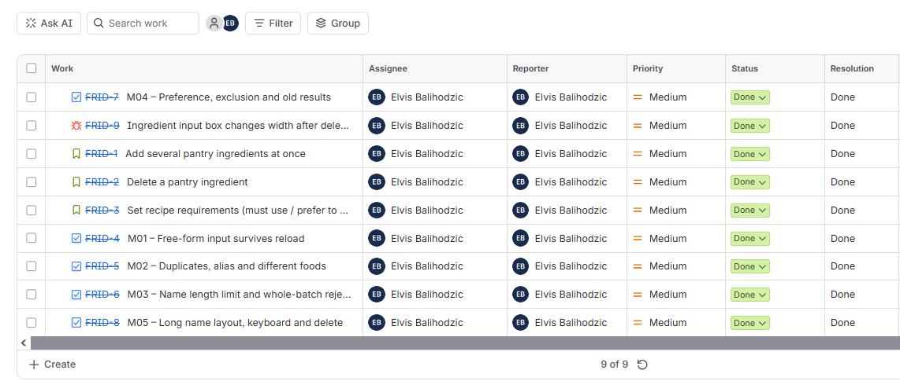
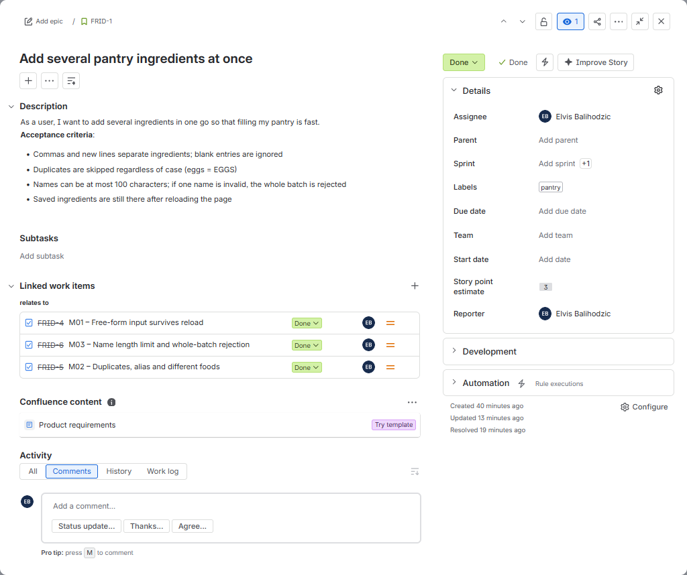
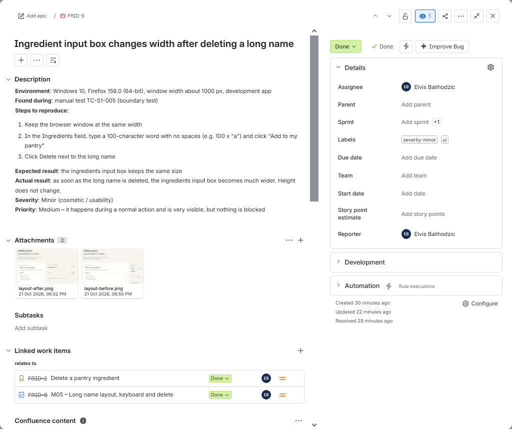
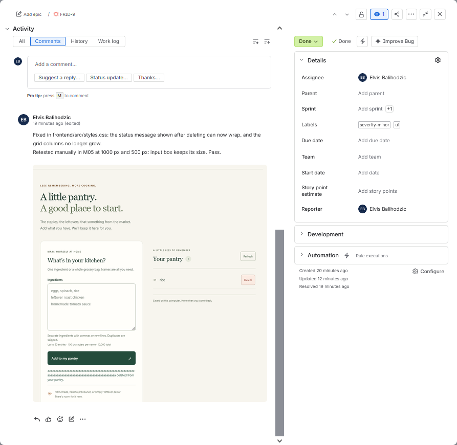
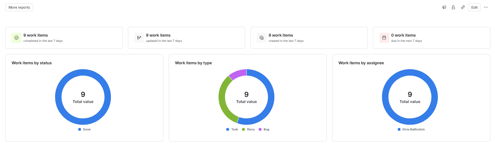
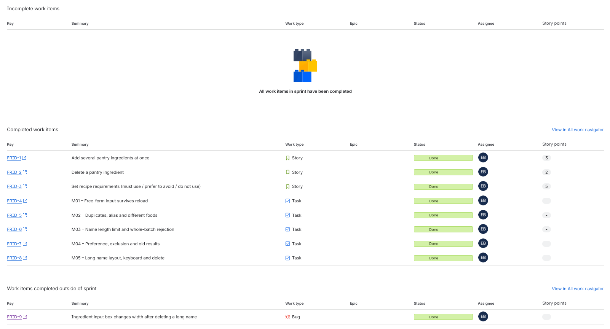
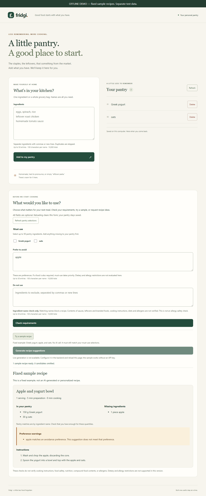

# Fridgi – QA portfolio project

Fridgi is a small pantry and recipe web app. You save the ingredients you have, choose what you must use or want to avoid, and get a recipe that shows what you already own and what is missing.

I used it as a practice project for manual QA: writing and running test cases, checking the API with Postman, comparing the UI with the database using SQL, and reporting a bug.

The app and its automated checks were built with AI from my idea. My part is the testing work below: test cases and execution, API and SQL checks, bug reporting, BDD scenarios and Jira.

## What I did

| What | Where |
| --- | --- |
| Five manual test cases (M01–M05), all run in Firefox | [Test cases](qa/manual/test-cases.md) · [Execution log](qa/manual/test-execution.md) |
| Earlier exploratory checks: bulk entry, duplicates, aliases, boundaries, preferences, sample and live recipes | [Execution log](qa/manual/test-execution.md#earlier-checks) |
| API checks in Postman and Swagger (GET pantry, POST recipe, a 422 I caused by sending the wrong body type) | [Execution log](qa/manual/test-execution.md#api-and-sql-checks) |
| SQL check comparing database rows with the API response | [Execution log](qa/manual/test-execution.md#api-and-sql-checks) · [SQL queries](qa/sql/pantry_checks.sql) |
| Found and reported a layout bug, then retested the fix | [BUG-001](qa/bugs/BUG-001-layout.md) |
| Rewrote the test cases as BDD scenarios in Gherkin | [qa/bdd](qa/bdd) |
| Set up the work in Jira afterwards to practise the workflow: stories with acceptance criteria, linked test cases, the bug and a one-week sprint | [Jira](#jira) |

Techniques used: boundary value analysis (99/100/101 characters), equivalence partitioning (duplicates, aliases, different foods), decision table (must use / prefer to avoid / do not use), state transitions (saved → deleted → reloaded), negative testing and a basic keyboard check.

## Jira

After testing, I set up the work in a Jira Scrum project (key `FRID`) to practise the workflow:

- **3 user stories** with acceptance criteria and story point estimates (3, 2, 5)
- **5 test cases** (M01–M05), each linked to the story it covers, with steps, expected result and result
- **1 bug** (BUG-001, `FRID-9`), linked to its story and to the retest case, with before/after screenshots and a closing comment
- **Sprint 1**: all 9 items completed. The bug shows as "completed outside of sprint" because I set it to Done before starting the sprint.

| | |
| --- | --- |
|  |  |
|  |  |
|  |  |

## What the app does

- Saves free-form ingredients (commas or new lines), including custom foods like "leftover roast chicken".
- Skips duplicates (`eggs` = `EGGS`) but keeps different foods apart (`tomato` ≠ `cherry tomatoes`).
- Lets you pick ingredients you **must use**, ones you **prefer to avoid** (warning only) and ones you **do not want** (recipe rejected).
- Rejects contradictory requests, for example "must use eggs" and "do not use eggs" (HTTP 422).
- Shows a fixed sample recipe offline, or live recipes from Groq if an API key is configured.



## Run it

Requires Python 3.13 and Node 22.12+. From the repository root in PowerShell:

```powershell
python -m venv .venv
.\.venv\Scripts\python.exe -m pip install -r backend/requirements.lock
.\.venv\Scripts\python.exe -m pip install --no-deps -e ./backend
npm.cmd --prefix frontend ci
npm.cmd --prefix frontend run build
.\.venv\Scripts\python.exe scripts/run_demo.py
```

Open http://127.0.0.1:8010. No API key is needed. The demo uses its own SQLite database in `.local-demo/`.

The [runbook](docs/runbook.md) has Linux/macOS commands, how to run the automated checks, Postman setup and how to open the database.

## Project structure

```
backend/     FastAPI + SQLAlchemy + SQLite (Alembic migrations), backend tests
frontend/    React + TypeScript (Vite)
qa/manual/   my test cases and execution log
qa/bdd/      test scenarios written in Gherkin (Given / When / Then)
qa/bugs/     bug reports
qa/jira/     Jira screenshots (stories, test cases, bug, sprint)
qa/api/      Postman collection and environment
qa/sql/      SQL queries used to check the database
qa/automation/  Selenium smoke tests (Chrome/Firefox)
docs/        expected behaviour (product contract), design decisions, runbook
```

## Limits

Local, single-user app. No login, quantities, nutrition, shopping list or diet/allergy checks. The ingredient checks compare names only and are not an allergy safety check.
